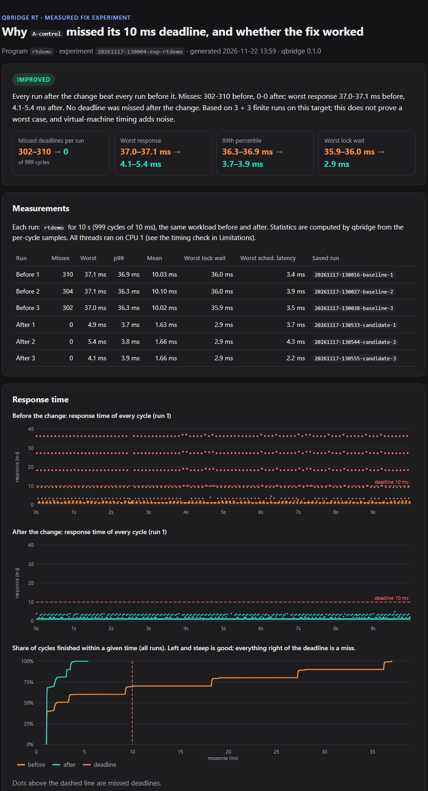

# qbridge RT

[](https://github.com/vychopade/qbridge/actions/workflows/ci.yml)

**Debugging tools tell you what happened. qbridge RT lets an AI assistant find out why a real-time task missed its deadline, test a fix, and measure whether it worked, on a real QNX 8.0 target.**

Built during the QNX Global Hackathon, November 2026 (Developer Tooling & Host Tools). Open source under the MIT licence. Project site with the example reports: **https://vychopade.github.io/qbridge/**

> **For judges, a 5-minute path**
> 1. Watch the demo video (under 3 minutes): *link added at submission*.
> 2. Open an example report in the browser: [mutex inversion](https://vychopade.github.io/qbridge/example-report.html), [message-passing inversion](https://vychopade.github.io/qbridge/example-report-msgpass.html), [CPU overload](https://vychopade.github.io/qbridge/example-report-overload.html).
> 3. Check the analysis on your own computer, no QNX needed: [Quick check without a target](#quick-check-without-a-target) (`qbridge replay`, 12 of 12 recorded results reproduced), or let your own AI assistant run the whole loop on the recorded data with `qbridge serve --replay`.
> 4. See the QNX-specific code: [How it uses QNX](#how-it-uses-qnx).

| Fault planted in the demo workload | Diagnosis (confirmed by a kernel trace) | Approved fix | Misses per 999 cycles, 3 runs before → 3 after |
|---|---|---|---|
| Mutex created with `PTHREAD_PRIO_NONE` | Priority inversion on a mutex | `PTHREAD_PRIO_INHERIT` (one line) | 310, 304, 302 → 0, 0, 0 |
| Server channel created with `_NTO_CHF_FIXED_PRIORITY` | Priority inversion through message passing | drop the flag (one line) | 825, 819, 812 → 9, 4, 24 |
| Control task below a CPU-heavy thread | CPU preemption | priority 15 → 30, same binary | 301, 309, 305 → 0, 1, 0 |

A wrong fix is measured too: raising the control task to priority 50 for the message-passing fault left the misses unchanged (798, 802, 801 → 798, 798, 798), and the verdict was "inconclusive", not "improved".



## The problem

In a real-time system a periodic task, such as a control loop, has to finish every cycle before its deadline. When it sometimes doesn't, the cause is rarely in the task itself. It might be a lower-priority thread holding a lock, a server answering at the wrong priority, a medium-priority thread taking the CPU, a late wake-up, or the previous cycle overrunning. Finding out which takes per-cycle timing, knowledge of who holds what and who waits for whom, and an understanding of priorities. Then the fix has to be tested on the target and *measured*, because a fix that looks right can still miss deadlines.

AI assistants can write QNX code, but they can't see the target, measure timing or run an experiment. qbridge RT gives them that, with a person approving every change.

### Who needs this, and why QNX

Teams building control software on QNX for robots, industrial machines, medical devices and vehicles add features all the time, and each one can upset the timing of a loop that used to be fine. The misses are often rare and caused by another part of the system. Today, finding the cause means capturing kernel traces by hand, reading them, guessing a fix and re-testing without a clear before-and-after.

QNX gives a deadline task the means to be on time: fixed-priority preemptive scheduling, priority inheritance on mutexes and through message passing, and a kernel trace detailed enough to confirm what happened. Those same mechanisms are where timing goes wrong when they are switched off or misused. Because QNX services are separate processes that talk by messages, an inversion through a server is a real risk that generic tools do not look for. qbridge RT turns these mechanisms into one repeatable loop that an AI assistant can drive and a person controls: diagnose with evidence, confirm with a trace, test one approved change, measure it.

## What it does

```
Detect  ->  Diagnose  ->  Propose  ->  (a person approves)  ->  Test  ->  Measure  ->  Verify
```

| Step | Tool (MCP / CLI) | What happens |
|---|---|---|
| Detect | `qnx_measure` / `qbridge measure` | Runs the workload for a fixed time. Every cycle's response is split into backlog, scheduling latency, lock wait, CPU time and preempted time, and each run of consecutive misses is attributed to what started it. The program's own numbers and qbridged's numbers are cross-checked. |
| Diagnose | `qnx_diagnose` | Takes thread-state snapshots from qbridged while the workload runs. Deterministic rules find a priority inversion on a mutex (the holder and the mutex protocol are read from the mutex in process memory), a priority inversion through QNX message passing (the task waits for a reply from a server process that runs below it while a middle-priority thread has the server's CPU), or CPU preemption (the deadline task is ready while a higher-priority thread has its CPU). When no other thread explains the misses, two more rules read the deadline report: own work overrun (cycles that used far more CPU time than usual) and late wake-up (the task started late with nothing ahead of it, compared with the target's measured timer lateness). Each finding lists its evidence, a confidence level and what it could not determine. With `trace`, a kernel trace from the same run checks every step of each finding; it is marked confirmed only if all of them are seen. |
| Propose | `qnx_experiment_propose` | One exact change, shown as a diff and not applied: an edit to one source file, or new workload arguments (a scheduling change such as a thread priority, with the same binary). |
| Approve | `qbridge experiment approve` | **Only a person, at an interactive terminal.** There is no MCP tool for it. The approval is tied to the diff's sha256. |
| Test | `qnx_experiment_run` | Applies the change, rebuilds with `qcc`, redeploys and reruns the identical workload. |
| Measure and verify | `qnx_experiment_run`, `qnx_report` | Compares before and after, with misses and worst-case response first. "Improved" means every run after the change beat every run before it; otherwise the result is "inconclusive". A self-contained HTML report is built only from recorded data, and `qnx_experiment_rollback` restores the baseline. |

### Result on the reference target

The demo workload [rtdemo](examples/rtdemo/README.md) has a 10 ms control task (priority 30), a CPU-heavy worker (20) and a logger (10) that shares a lock with the control task. The lock is created with `PTHREAD_PRIO_NONE`, which turns off QNX's default priority inheritance. That's the planted fault.

qbridge's diagnosis, live on the target:

> **Priority inversion on a mutex (high confidence).** 'A-control' (priority 30) waits for a mutex held by 'C-logger' (priority 10), while 'B-worker' (priority 20) keeps the CPU. Evidence: blocked in 9 of 25 snapshots for up to 32 ms; holder read from the mutex's owner word; middle-priority thread running in all 9; protocol flags say PTHREAD_PRIO_NONE; 76 of 76 runs of misses started with a long lock wait.

The fix it proposed (restore `PTHREAD_PRIO_INHERIT`), approved by a person at the prompt, then measured (3 runs of 10 s each way):

| | Before | After |
|---|---|---|
| Missed deadlines (of 999 cycles per run) | 310, 304, 302 | **0, 0, 0** |
| Worst response | 37.0–37.1 ms | **4.1–5.4 ms** |
| 99th percentile | 36.3–36.9 ms | 3.7–3.9 ms |
| Worst lock wait | 35.9–36.0 ms | 2.9 ms |

The verdict was "improved": every run after the change beat every run before it. It also stated its own limits: *based on 3 + 3 finite runs on this target; this does not prove a worst case, and virtual-machine timing adds noise.* The full report is [docs/example-report.html](docs/example-report.html) (download it and open it in a browser).

A kernel trace from the same kind of run confirmed each step of the finding: in one second, 'A-control' was blocked on the mutex for 351.9 ms. For 94% of that time 'C-logger' was ready but not running, still at priority 10, while 'B-worker' ran on its CPU. All 10 waits ended while 'C-logger' was running, which is when it released the lock.

**Second scenario: CPU overload with the wrong priorities.** `rtdemo -s overload -a 15` uses no lock; the control task runs at priority 15, below the CPU-heavy worker at 20. qbridge found **CPU preemption (high confidence)**: the control task was ready while 'B-worker' held its CPU, and every run of misses started with waiting for the CPU, none with a lock. The kernel trace confirmed it: the control task was ready for 334.4 ms of one second, and 'B-worker' ran on its CPU for 95% of that time. The proposed fix was a scheduling change with the same binary (`-a 30`), approved at the prompt and measured the same way:

| | Before (`-a 15`) | After (`-a 30`) |
|---|---|---|
| Missed deadlines (of 999 cycles per run) | 301, 309, 305 | **0, 1, 0** |
| Worst response | 36.1–46.2 ms | **5.0–10.6 ms** |
| 99th percentile | 35.5–36.1 ms | 3.0 ms |

Verdict "improved". The one miss after the change started with a late wake-up (9.2 ms), not with preemption; that day's timer check measured CPU 1's wake-ups up to 28.4 ms late. Report: [docs/example-report-overload.html](docs/example-report-overload.html).

**Third scenario: priority inversion through message passing, a QNX-specific fault.** On QNX, services are separate processes that receive messages, and a server thread that receives a message normally runs at the sending client's priority. `rtdemo -s msgpass` has the control task ask a separate server process (priority 10) for a result each cycle with `MsgSend`; the server's channel is created with `_NTO_CHF_FIXED_PRIORITY`, which turns that inheritance off. No mutex is involved. qbridge found **priority inversion through message passing (high confidence)**: the control task (30) was REPLY-blocked on the server, the server's thread ran at 10, and 'B-worker' (20) had its CPU; every run of misses started with a long wait for the server's reply (40-90 ms against a usual 4 ms). The kernel trace confirmed each step: whenever the server was not doing the work during the control task's waits, it was READY at priority 10 (100% of that time) while 'B-worker' ran, and all 100 waits ended while the server was running. The proposed fix was one line (create the channel without the flag), approved at the prompt and measured the same way:

| | Before | After |
|---|---|---|
| Missed deadlines (of 999 cycles per run) | 825, 819, 812 | **9, 4, 24** |
| Worst response | 54.2-96.0 ms | **19.0-28.0 ms** |
| 99th percentile | 48.3-75.2 ms | 7.3-18.4 ms |

Verdict "improved": every run after the change beat every run before it, but the task still missed a few deadlines. In those cycles the server's 4 ms of work took 8-13 ms of wall time and the control task's own 1 ms of work up to 10 ms, with no thread at or above their priority competing on that CPU; that session's timer check measured CPU 1's wake-ups up to 9.9 ms late. This points to the virtual machine slowing the guest, not to the inversion, but these runs cannot prove it. Report: [docs/example-report-msgpass.html](docs/example-report-msgpass.html).

**A fix that should not help, measured as not helping.** An obvious-looking fix for the third fault is to make the control task more important: run it at priority 50, above everything else, with the same binary and the channel flag left in. It cannot work, because the server still serves the request at its own fixed priority 10, below 'B-worker'. qbridge does not take that on faith: the change was proposed, approved at the prompt and measured like the others.

| | Before (`-s msgpass`) | After (`-s msgpass -a 50`) |
|---|---|---|
| Missed deadlines (of 999 cycles per run) | 798, 802, 801 | 798, 798, 798 |
| Worst response | 46.6-50.5 ms | 46.0-46.5 ms |

Verdict "inconclusive" and the recommendation "do not rely on this change", then a rollback. A diagnosis with a kernel trace at priority 50 found the same inversion, confirmed step by step: the control task waited at 50, the server was ready at 10 for 401 ms of the second while 'B-worker' (20) had its CPU for 400 ms of that. Report: [docs/example-report-wrongfix.html](docs/example-report-wrongfix.html).

## How it uses QNX

The target side is native QNX 8.0 C code. These are the places to look:

| Where | What | QNX technology |
|---|---|---|
| [target/qbridged/qbridged.c](target/qbridged/qbridged.c) `main`, `qb_read`, `qb_ocb_calloc` | A resource manager serving live system state as files under `/dev/qbridge` | `resmgr_attach`, `iofunc_*` layer with a custom OCB, `dispatch_*` |
| `walk_threads`, `emit_blocked`, `thread_name` | Every thread's state, priority, blocked-on details and how long it has been blocked | procfs `DCMD_PROC_INFO` / `DCMD_PROC_TIDSTATUS`, `ThreadCtlExt(_NTO_TCTL_NAME)` |
| `read_sync` | The holder and protocol of the mutex a thread is blocked on, read from the `sync_t` in that process's memory | `/proc/<pid>/as` with `pread64`; `_NTO_SYNC_*` flags |
| `setup_events`, `on_pulse`, `events_read`, `qb_unblock` | Process-death and core-dump events pushed by pulses; a read of `/dev/qbridge/events` blocks until something happens | `procmgr_event_notify_add`, `DCMD_DUMPER_NOTIFYEVENT`, `MsgRegisterEvent`, `pulse_attach`, held replies (`_RESMGR_NOREPLY`, `MsgReply`, `MsgError`) |
| [target/qbridged/qbridge_task.h](target/qbridged/qbridge_task.h) `qbt_register`, `qbt_report` | A real-time task registers once, then reports every cycle without ever blocking | `devctl` (a `MsgSend`) to register; `MsgSendPulse` per cycle |
| [target/qbridged/qb_deadlines.c](target/qbridged/qb_deadlines.c) `qbd_devctl`, `qbd_on_pulse` | Per-task deadline statistics in memory set aside at startup, served at `/dev/qbridge/deadlines`; pulses accepted only from the registering connection | resmgr devctl handler, pulse handler, kernel-supplied `scoid` |
| [examples/rtdemo/rtdemo.c](examples/rtdemo/rtdemo.c) `LOCK_PROTOCOL`, `task_a`, `setup_thread`, `scenario`, `a_prio` | The demo workload: periodic task, CPU pinning, FIFO priorities, the mutex protocol; three scenarios (`-s inversion`, `-s overload`, `-s msgpass`) and the control task's priority (`-a`) | `pthread_mutexattr_setprotocol`, `clock_nanosleep(TIMER_ABSTIME)`, `ThreadCtl(_NTO_TCTL_RUNMASK)`, `SCHED_FIFO` |
| `SERVER_CHANNEL_FLAGS`, `run_server`, `start_server` | The `-s msgpass` server: a separate process that answers the control task's messages; its channel is created with `_NTO_CHF_FIXED_PRIORITY` (the planted fault), and it exits when the client's connection goes away | `ChannelCreate`, `_NTO_CHF_FIXED_PRIORITY`, `_NTO_CHF_DISCONNECT`, `ConnectAttach`, `MsgSend`, `MsgReceive`, `MsgReply` |
| [src/qbridge/analysis.py](src/qbridge/analysis.py) `mutex_inversion`, `msgpass_inversion`, `cpu_preemption`, `late_wakeup` | The diagnosis rules over qbridged's thread snapshots and the deadline report | thread states `MUTEX`, `SEND`, `REPLY`, `READY`; the server process from `blocked_on.pid`; QNX priority inheritance on mutexes and through message passing |
| [target/tools/vmjitter.c](target/tools/vmjitter.c) `timer_mode` | Measures how late timers fire on each CPU (the environment's noise floor) | `clock_nanosleep`, run masks |
| [target/image/snippets](target/image/snippets) | Builds qbridged into the target image and starts it at boot | `mkqnximage` snippets |
| [docs/codelab/livedata](docs/codelab/livedata) `live_read`, `live_write`, `live_ocb_calloc` | The codelab's stand-alone example: a resource manager serving `/dev/livedata/uptime` (live, read-only) and `/dev/livedata/message` (writable) | `resmgr_attach`, custom attribute and OCB, `iofunc_read_verify` / `iofunc_write_verify`, `resmgr_msgget` |
| [src/qbridge/tools.py](src/qbridge/tools.py) `capture_trace`; [commands.py](src/qbridge/commands.py) `_rule_tracelogger` | Records a short kernel trace on the target in the same run as the diagnosis and decodes it on the host | instrumented kernel `procnto-smp-instr`, `tracelogger` (wide mode, class filters), SDP `traceprinter` |
| [src/qbridge/parsers/kev.py](src/qbridge/parsers/kev.py) `parse`; [src/qbridge/traceconfirm.py](src/qbridge/traceconfirm.py) `confirm_preemption`, `confirm_inversion`, `confirm_msgpass` | Turns kernel events into per-thread state spans and checks each step of a finding against them | `THREAD` class events (`THRUNNING`, `THREADY`, `THMUTEX`, `THSEND`, `THREPLY`, ...), `PROCTHREAD_NAME`, `CONTROL TIME` |

The host side (Python, no dependencies beyond the standard library) builds with the SDP's `qcc`, talks to the target over ssh, and analyses gdb output when crash analysis is used. [docs/ARCHITECTURE.md](docs/ARCHITECTURE.md) explains how the pieces fit together.

## Quick check without a target

You can check the analysis on any computer with Python 3.10 or newer, without QNX or a target:

```
git clone https://github.com/vychopade/qbridge.git
cd qbridge
python -m venv .venv
.venv\Scripts\activate
pip install -e .
qbridge replay
```

`qbridge replay` runs qbridge's diagnosis rules, kernel-trace checks and experiment verdicts on data recorded on the reference target (thread snapshots, deadline reports, kernel traces and per-run reports, kept in `tests/fixtures/`). It then compares each result with what qbridge reported on the target at the time. It ends with:

```
12 of 12 results are the same as qbridge reported on the target.
```

It measures nothing new. It shows that the analysis is deterministic and reproduces the recorded results. On Linux or macOS, activate the venv with `source .venv/bin/activate`.

Then:
- **Let an AI assistant run the loop, with no target:** `qbridge serve --replay` is the MCP server answering from data recorded on the target. In Claude Code: `claude mcp add qbridge-replay -- <path to the clone>\.venv\Scripts\qbridge.exe serve --replay`, then ask why `rtdemo -s msgpass` misses its deadline. The assistant measures, diagnoses (with the recorded kernel trace), proposes one change and asks you to approve it with `qbridge experiment approve <id>` in a terminal, then gets the verdict. The analysis is qbridge's real code; every result says when its data was recorded; only the changes measured on the target can be measured, anything else is refused ([details](docs/TOOLS.md#replay-mode-no-target)).
- `qbridge trace --file examples/traces/msgpass.txt.gz` analyses a full kernel trace recorded on the target: per-thread states, who held the CPU during each wait, and a hint that the control task was blocked while its server was held off the CPU by a middle-priority thread. It writes an HTML page with the timeline, and with `--perfetto` a file to open in [Perfetto](https://ui.perfetto.dev) ([this trace in Perfetto](https://ui.perfetto.dev/#!/?url=https://vychopade.github.io/qbridge/traces/msgpass.perfetto.json)). It works on any program's `traceprinter` output, not only the demo's ([examples/traces](examples/traces/README.md)).
- `pip install -e ".[dev]"` and `pytest` run the full test suite, which also uses recorded target output.
- Open [docs/example-report.html](docs/example-report.html) (priority inversion, fixed in the source) [docs/example-report-overload.html](docs/example-report-overload.html) (CPU preemption, fixed by a priority change) and [docs/example-report-msgpass.html](docs/example-report-msgpass.html) (priority inversion through message passing, fixed in the source) in a browser. These are the HTML reports from the recorded experiments, with the kernel trace timelines.
- The codelab, [docs/codelab](docs/codelab/README.md), walks through writing a small QNX resource manager; that part needs the QNX SDP and a target.

## Build and run

### What you need

| | Used and tested |
|---|---|
| Host | Windows 11 |
| QNX | QNX SDP 8.0 (QNX Everywhere licence): `qcc` with gcc 12.2.0 (`gcc_ntox86_64`), GNU make 4.4.1, `ntox86_64-gdb` 14.2 |
| Target | QNX 8.0 x86_64 image built with `mkqnximage`, running in VirtualBox 7.2 with 2 virtual CPUs |
| Python | 3.10 or newer (tested with 3.14); no third-party packages, and `pytest` for the tests |
| Other | Git, and Windows' built-in OpenSSH client |

The host code also supports `qnxsdp-env.sh` on Linux, but only a Windows host has been tested. The commands below are for a Windows Command Prompt.

### 1. Create the target

```
call %USERPROFILE%\qnx800\qnxsdp-env.bat
ssh-keygen -t ed25519 -f %USERPROFILE%\.ssh\qnx_target_ed25519 -N ""
mkdir %USERPROFILE%\qnx-target && cd %USERPROFILE%\qnx-target
mkqnximage --type=vbox --arch=x86_64 --ssh-ident=%USERPROFILE%/.ssh/qnx_target_ed25519.pub --run
```

On Windows, `mkqnximage` supports VirtualBox or VMware; QEMU needs a Linux host. VirtualBox needs a host-only network with DHCP, and the default one works.

### 2. Install qbridge on the host

```
git clone https://github.com/vychopade/qbridge.git
cd qbridge
python -m venv .venv
.venv\Scripts\activate
pip install -e ".[dev]"
pytest
```

The tests use output recorded on a real target, so they need no target.

qbridge finds the target's address with `mkqnximage --getip` in `%USERPROFILE%\qnx-target` and remembers it. Set `QBRIDGE_HOST` to skip that. Other settings are in [docs/TOOLS.md](docs/TOOLS.md#configuration).

### 3. Build the target programs and start qbridged at boot

```
qbridge build target\qbridged
qbridge image install
pushd %USERPROFILE%\qnx-target
mkqnximage --stop
mkqnximage --build --run
popd
qbridge ps --process qbridged
```

`qbridge build` runs `make` with the SDP environment loaded. Plain `make -C target\qbridged` works too, after `qnxsdp-env.bat`. `qbridge image install` copies qbridged and two `mkqnximage` snippets into the image folder; rebuilding the image puts qbridged at `/system/bin/qbridged` and starts it at boot. Rebuilding resets the target's `/data` partition.

Then build and copy the workload and the timing check to the target:

```
qbridge build examples\rtdemo
qbridge build target\tools
qbridge --allow-write deploy examples\rtdemo\build\rtdemo
qbridge --allow-write deploy target\tools\build\vmjitter
```

### 4. Check the target's timing first

```
qbridge --allow-write timing-check --cpu 1
qbridge --allow-write timing-check --cpu 0
```

This measures how late a high-priority 1 ms timer fires with nothing else running. **On the reference VirtualBox VM, CPU 0's timers were 15–19 ms late on average (worst about 55–63 ms), while CPU 1 usually stayed within a few ms (worst 1.9–2.3 ms; one noisier session on Nov 22 reached 28 ms).** That's why rtdemo runs on CPU 1 (`-c` to change it). The report quotes these checks.

### 5. Run the workflow

```
qbridge --allow-write measure rtdemo --seconds 10 --label baseline
qbridge --allow-write diagnose rtdemo --seconds 8 --trace

qbridge --allow-write experiment start rtdemo --project examples\rtdemo --repeats 3
qbridge experiment propose <id> --file rtdemo.c --find "#define LOCK_PROTOCOL PTHREAD_PRIO_NONE" --replace "#define LOCK_PROTOCOL PTHREAD_PRIO_INHERIT" --description "Restore priority inheritance on the shared lock"
qbridge experiment approve <id>
qbridge --allow-write experiment run <id>
qbridge report <id>
qbridge --allow-write experiment rollback <id>
```

`experiment approve` shows the diff and waits for you to type `yes`. Run it in a normal terminal window. `report` writes `%USERPROFILE%\.qbridge\reports\<id>.html`. `rollback` puts the original source and binary back, which keeps the demo's fault in place.

### 6. Let an AI assistant drive it

qbridge is also an MCP server on stdio. For Claude Code:

```
claude mcp add qbridge -- C:\path\to\qbridge\.venv\Scripts\qbridge.exe serve --allow-write
```

Leave out `--allow-write` to give the assistant read-only access. Any MCP client that can start a stdio server works the same way. The assistant can measure, diagnose, propose and run experiments, but it cannot approve its own change.

No target? `qbridge serve --replay` runs the same loop on data recorded on the target (see [Quick check without a target](#quick-check-without-a-target)).

### 7. Keep it fixed: a regression check for CI

```
qbridge --allow-write gate rtdemo --repeats 3 --max-misses 0
```

`gate` measures the workload several times and exits with code 1 if any run misses more deadlines than allowed, has a worst response above `--max-worst-ms`, or is worse than saved runs given with `--baseline <run id> ...`. A CI job on a machine with a lab target can run it after every build. On the reference target the planted inversion failed it (196 and 200 misses in two 5-second runs) and the fixed overload configuration passed with `--max-misses 2`. Passing means those runs met the limits, not that the deadline can never be missed.

## Safety

- **Read-only by default.** Anything that changes the target needs `--allow-write`, and the assistant cannot switch that on.
- **A person approves every source change** at an interactive prompt, tied to the exact diff.
- **Command allowlist.** There is no free-form command tool. Every command sent to the target is checked against a list of programs and argument rules, and scripts are allowed only as fixed templates. Uploads and program runs are confined to `/data/qbridge`, and only programs qbridge deployed can be signalled.
- **Timeouts on everything; rollback** to the saved baseline binary, checked by sha256.
- **Audit log** of every action, including refusals and approvals, in a hash chain (`qbridge audit --verify`). It is tamper-evident, not tamper-proof.

[docs/TOOLS.md](docs/TOOLS.md#guard-rails) shows where each guard rail is enforced and which tests check it.

## What the measurements do and do not show

- They come from **finite runs on a QNX 8.0 virtual machine**. They show the effect of a change on this workload; they do not prove a worst-case response time or that a deadline can never be missed.
- Virtual-machine timing is noisier than real hardware, and absolute numbers vary between boots (the faulty build missed about 300 deadlines in one boot and 384 in another). Only runs from the same session are compared.
- rtdemo is an **educational, simulated** workload. Nothing here is a claim about any automotive, medical or other safety-certified system.
- The mutex owner's layout in memory was **observed** on QNX 8.0, not taken from documentation. qbridged checks it against the process ID on every read, and findings say so.
- **qbridge's own overhead** was measured on Nov 23 with a workload that rarely misses (`rtdemo -s overload -a 30`), six interleaved 10 s runs in each of three conditions: rtdemo not reporting to qbridged (`-n`), reporting every cycle (the normal mode), and reporting while the host read qbridged's thread snapshots over ssh about once a second (`qbridge ps` in a loop), as `diagnose` does. The typical cycle did not change: median response 1.083, 1.079 and 1.089 ms, mean 1.256, 1.249 and 1.254 ms. The quiet runs had no misses; four of the twelve runs with qbridge active had a few (2, 4, 5 and 4), all in the first three rounds, none in the last three. Every one of those runs of misses started with the control task waking 9.8-46.9 ms late with almost nothing running above it (at most 0.2 ms preempted), which is how the virtual machine pausing the guest looks; qbridged runs below the control task. Eighteen runs cannot tell whether qbridge's activity made those pauses more likely, so this is stated, not ruled out. The data is in `tests/fixtures/overhead/`.

## Also included

The general QNX debugging tools from the project's first phase still work and are documented in [docs/TOOLS.md](docs/TOOLS.md):
- process and thread listing with deadlock and message-passing inversion detection;
- slog2 logs and process-death and core-dump events;
- crash analysis with gdb;
- three more demo programs with planted bugs ([examples/](examples/README.md)).

## Repository layout

| Path | Contents |
|---|---|
| `src/qbridge/` | Host side: MCP server (`server.py`), CLI (`cli.py`), tools, measurement and analysis, experiments, report, safety |
| `target/qbridged/` | The QNX resource manager and the task reporting header ([README](target/qbridged/README.md)) |
| `target/tools/` | `vmjitter`, the timing check |
| `target/image/` | `mkqnximage` snippets to build qbridged into the image |
| `examples/rtdemo/` | The real-time demo workload ([README](examples/rtdemo/README.md)) |
| `examples/traces/` | Kernel traces recorded on the target, for `qbridge trace --file` ([README](examples/traces/README.md)) |
| `examples/` | Other demo programs |
| `tests/` | The tests; `tests/fixtures/` holds output recorded on the real target (also used by `qbridge replay`) |
| `docs/` | [ARCHITECTURE.md](docs/ARCHITECTURE.md), [TOOLS.md](docs/TOOLS.md), the codelab, the two example reports |
| `docs/codelab/` | The codelab "Write a QNX resource manager that serves live data as files" and its example |
| `hackathon/` | Hackathon material: [DEMO_SCRIPT.md](hackathon/DEMO_SCRIPT.md) (video script), [SUBMISSION.md](hackathon/SUBMISSION.md) (Devpost text) |

## Licence

MIT, see [LICENSE](LICENSE).
