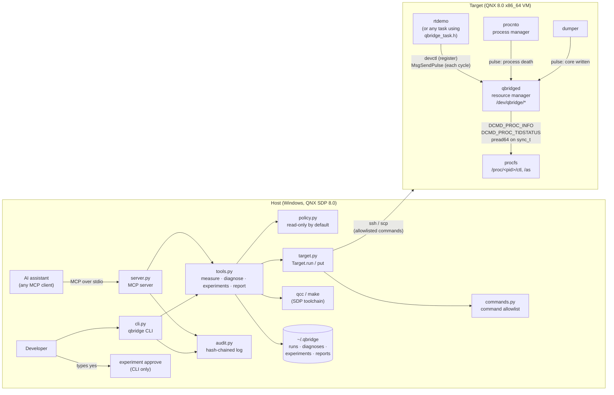
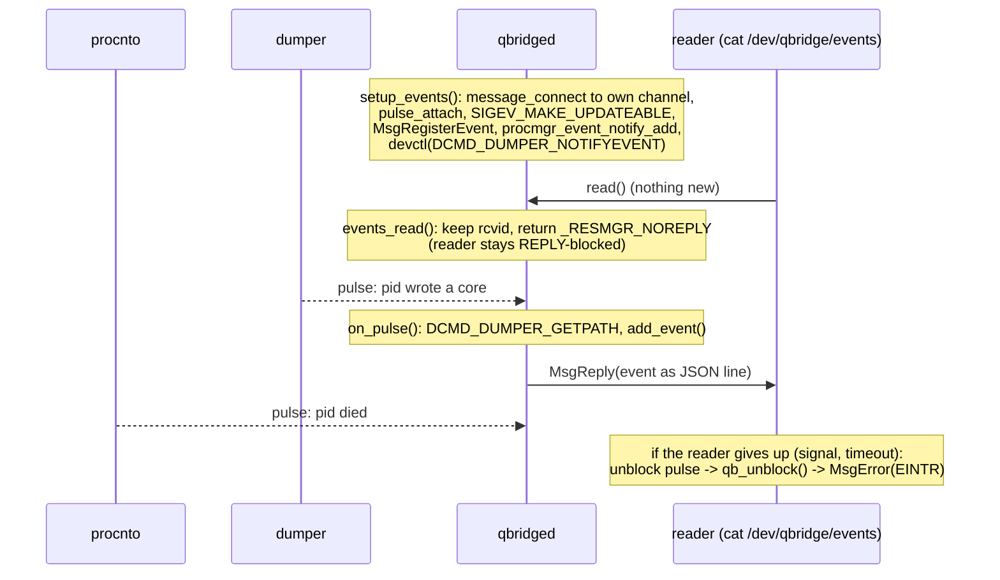
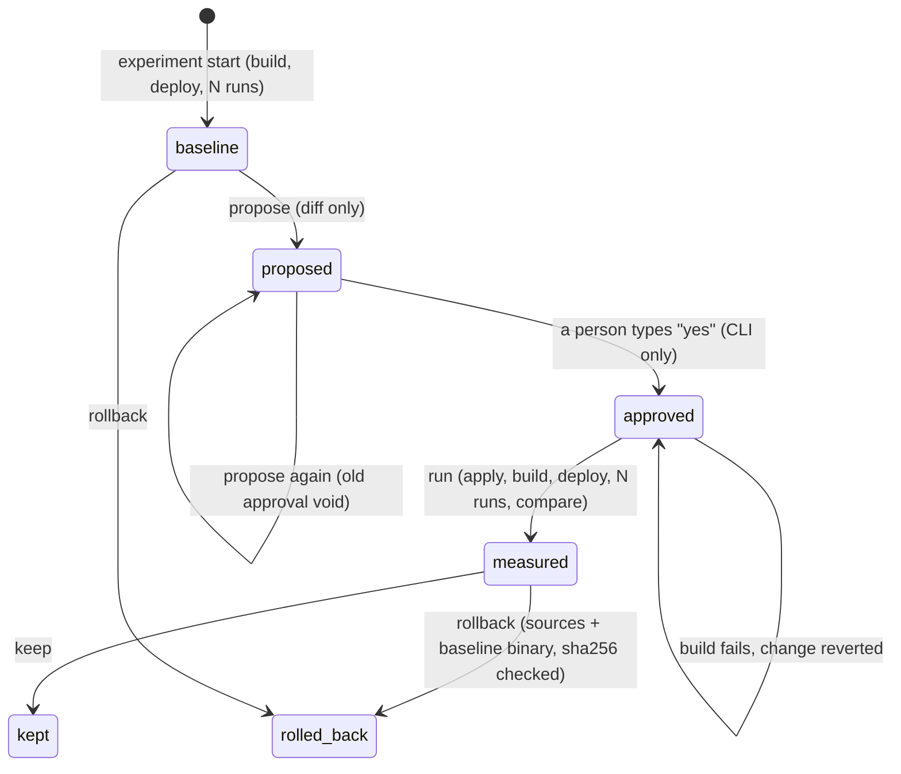

# qbridge RT architecture

qbridge RT has two halves: a **host side** in Python (an MCP server and a CLI that share the same tools) and a **target side** in native QNX 8.0 C (the `qbridged` resource manager, a small header for real-time tasks, and the demo workload). They talk over ssh. On the target, the pieces talk to each other with QNX message passing.



## The workflow, and where each step happens

| Step | Host | Target | Data saved |
|---|---|---|---|
| Detect | `tools.measure` runs the workload under `timeout`, fetches its per-cycle CSV, and `deadlines.analyse` computes statistics and attributes misses | rtdemo records each cycle itself and also reports it to qbridged by pulses | `runs/<id>/` with meta (binary sha256), the program's summary, samples and report |
| Cross-check | `deadlines.cross_check` against the program's summary; `qbridged.cross_check` against `/dev/qbridge/deadlines` | qbridged's own statistics, gathered by message passing | stored in the run's report |
| Diagnose | `tools.diagnose` takes snapshots of `/dev/qbridge/threads` while the workload runs; `analysis.mutex_inversion`, `analysis.msgpass_inversion` and `analysis.cpu_preemption` apply the rules; with `trace`, `tools.capture_trace` and `traceconfirm.confirm_all` check the findings | qbridged reads thread state from procfs and the mutex from process memory; `tracelogger` records kernel events | `diagnoses/<id>.json` with the supporting snapshots and trace checks; raw traces in `traces/<id>/` |
| Propose | `experiments.propose`: one exact replacement, diff only | none | `experiments/<id>/experiment.json` |
| Approve | `cli.approve_interactively`: interactive terminal only, tied to the diff's sha256 | none | approval in the experiment record and the audit log |
| Test | `experiments.run`: apply, `qcc` build, deploy, rerun N times | new binary under `/data/qbridge` | candidate runs |
| Verify | `deadlines.compare_sets`, then `report.build` | none | the verdict and `reports/<id>.html` |
| Rollback | `experiments.rollback`: restore the sources, redeploy the saved baseline binary, compare sha256 | baseline binary again | rollback result in the record |

The data folder is `%USERPROFILE%\.qbridge` (`QBRIDGE_HOME` to change it). The report is built only from these files.

## Target side

### qbridged: a resource manager for system state

[target/qbridged/qbridged.c](../target/qbridged/qbridged.c) attaches one path per file with `resmgr_attach` and serves JSON (CSV for `samples`):

| File | Contents | How it is gathered |
|---|---|---|
| `/dev/qbridge/threads` | Every thread: state, priority and real priority, policy, name, last CPU, `blocked_ms`, and what it is blocked on | `walk_threads`: opens `/proc/<pid>/ctl`, `DCMD_PROC_INFO`, then `DCMD_PROC_TIDSTATUS` for each thread; names via `ThreadCtlExt(_NTO_TCTL_NAME)` |
| `/dev/qbridge/blocked` | SEND/REPLY edges: which process each thread is waiting on, with the channel | from `debug_thread_t.blocked.connect` |
| `/dev/qbridge/procs`, `/dev/qbridge/crashes`, `/dev/qbridge/version` | Processes; core files written by dumper | procfs, `/proc/<pid>/exefile`, the dumper folder |
| `/dev/qbridge/events` | Process deaths and new core dumps as JSON lines; a read blocks until there is something new | see "Events" below |
| `/dev/qbridge/deadlines`, `/dev/qbridge/samples` | Per-task deadline statistics and recent cycles | see "Deadline reporting" below |

Each `open()` takes one consistent snapshot, held in a custom OCB (`qb_ocb_calloc`, `qb_ocb_free`). `qb_read` returns slices of it with `_RESMGR_NPARTS`. qbridged runs at the default priority 10, single-threaded, and makes itself a daemon with `procmgr_daemon`.

#### Who holds the mutex

For a thread in state `MUTEX`, the kernel reports the address of the sync object (`blocked.sync.sync`) but not its owner. `read_sync` reads the 8-byte `sync_t` at that address with `pread64` on `/proc/<pid>/as`:

- `__u.__count` holds documented `_NTO_SYNC_*` flags (`sys/target_nto.h`). `_NTO_SYNC_PRIONONE` means `PTHREAD_PRIO_NONE`, `_NTO_SYNC_PRIOCEILING` means `PTHREAD_PRIO_PROTECT`, and neither means `PTHREAD_PRIO_INHERIT`.
- `__owner` is documented only as "thread id for mutex". On the target it was observed to be `_NTO_SYNC_WAITING | (pid & 0x7fff) << 16 | tid`. qbridged decodes the tid and reports whether the pid bits match the process (`mutex_owner_pid_bits_match`), and the analysis names a holder only when they do.

#### Events



A death pulse arrives after the process has left `/proc`, so names come from a pid-to-path cache filled at startup, on create pulses, and on every snapshot.

### Deadline reporting by message passing

A periodic task includes [qbridge_task.h](../target/qbridged/qbridge_task.h) (header only):

```mermaid
sequenceDiagram
    participant T as real-time task (e.g. rtdemo thread A)
    participant Q as qbridged (qb_deadlines.c)
    T->>Q: qbt_register(): open /dev/qbridge/deadlines,<br/>devctl(DCMD_QBT_REGISTER) = MsgSend (once, before the loop)
    Q-->>T: slot, pulse code, pulse priority (qbridged's own)
    loop every cycle
        T--)Q: qbt_report(): 5 x MsgSendPulse<br/>(backlog, latency, lock wait, CPU time, response)
        Note over Q: qbd_on_pulse(): accept only from the<br/>registering scoid; response completes the cycle
    end
    T->>Q: close()
    Note over Q: qbd_close(): slot ends; pulses from that<br/>connection still accepted for 2 s
```

- **The task never blocks on qbridged.** A pulse is queued by the kernel, and pulses are sent at qbridged's own low priority, so delivering them never runs qbridged above the task.
- **Memory is set aside once.** Statistics live in a static array: 16 tasks, each with the last 4096 cycles for percentiles plus running totals. Memory is allocated only when someone reads a file.
- **Trust.** A pulse counts only if its `scoid` (filled in by the kernel) matches the connection that registered the slot.
- **Found on the target:** a task's `close()` is a message sent at the task's high priority, so it overtook the task's last low-priority pulses and the last cycle was lost. qbridged now accepts that connection's pulses for 2 s after the close.
- **Checked on the target:** qbridged's statistics and rtdemo's own measurements agree exactly on cycles, misses, worst and 99th percentile, with means within 0.2 µs. `qnx_measure` repeats this check on every run.

### rtdemo, the workload

[examples/rtdemo/rtdemo.c](../examples/rtdemo/rtdemo.c) runs three `SCHED_FIFO` threads pinned to one CPU with `ThreadCtl(_NTO_TCTL_RUNMASK)`. Thread A sleeps to absolute release times with `clock_nanosleep(TIMER_ABSTIME)` and measures each cycle's parts separately:
- **backlog**: the previous cycle overran;
- **scheduling latency**: wake-up minus the moment it could start;
- **lock wait**;
- **CPU time**, from `CLOCK_THREAD_CPUTIME_ID`;
- **response**.

The workload has fixed phases, so before and after runs are comparable. The fault is a single line, `LOCK_PROTOCOL`.

## Host side

| Module | Role |
|---|---|
| `server.py` | MCP server over stdio, written directly on JSON-RPC (no SDK dependency). Each tool declares whether it can change the target. |
| `cli.py` | The same tools from a terminal; `experiment approve` exists only here. |
| `tools.py` | The tool implementations: `measure`, `diagnose`, `deadline_stats`, `timing_check`, `make_report`, `deploy`, `run`, `kill` and the rest. |
| `deadlines.py` | Statistics, miss attribution, `compare` and `compare_sets` (strict: every run must beat every run), and cross-checks. |
| `analysis.py` | Deterministic rules over snapshots and deadline reports: findings with evidence, confidence and unknowns. |
| `parsers/kev.py` | Decoded kernel traces (`traceprinter` output) to per-thread state spans, with the 32-bit time-stamp wrap handled. |
| `traceconfirm.py` | Checks each step of a finding against a kernel trace from the same run; "confirmed" only if every step is seen. |
| `experiments.py` | Experiment states: baseline, proposed, approved, measured, then kept or rolled back. |
| `report.py` | The self-contained HTML report: inline CSS and SVG, no scripts. |
| `target.py` | ssh and scp with the options this setup needs, and the cached target address. |
| `commands.py` | The command allowlist checked in `Target.run`. |
| `policy.py` | Read-only default and the deploy folder. |
| `audit.py` | The append-only, hash-chained audit log. |
| `build.py`, `qnxenv.py` | Run `make` or `qcc` with the SDP environment, and parse compiler and linker errors. |
| `parsers/` | `pidin`, `slog2info` and qbridged output. |
| `crash.py`, `image.py`, `runs.py` | Crash analysis with gdb, the image snippets, and saved data. |



## Design choices

- **Measure inside the task as well as from outside.** The task's own per-cycle timestamps are the most direct measurement. qbridged's copy, gathered by message passing, and the host's recomputation from raw samples are cross-checks, and all three agreed on every run.
- **Split each cycle into parts.** A miss caused by a lock wait needs a different fix from one caused by a late wake-up. On this VM, late wake-ups do happen (see vmjitter), and the analysis keeps them apart from the lock problem.
- **Snapshots to find, a kernel trace to confirm.** Thread-state snapshots are cheap and show the holder, the waiter and the middle-priority thread at the same instant, including the mutex owner, which the trace does not record. They are instants, not a timeline, and findings say so. An optional one-second kernel trace (`tracelogger`), taken in the same run so process and thread ids match, adds the timeline: every state change, so each step of a finding can be checked and timed.
- **Strict verdicts.** "Improved" needs every candidate run to beat every baseline run on both misses and worst case; overlap is "inconclusive". This favours saying "not shown" over a false "fixed".
- **A person approves changes, outside MCP.** An assistant proposes; only an interactive terminal can approve. Approval binds to the diff's hash.
- **One place where commands leave the host.** `Target.run` is the only way to execute on the target, so the allowlist and the audit cover everything.

## What is documented, observed or assumed

| Item | Status |
|---|---|
| Default mutex protocol `PTHREAD_PRIO_INHERIT` | Documented (`pthread_mutexattr_init`) and confirmed on the target |
| `_NTO_SYNC_PRIONONE` and other count flags | Documented in `sys/target_nto.h`, and seen in rtdemo's mutex |
| Mutex owner word layout (pid bits and tid) | **Observed** on QNX 8.0 in three runs and checked on every read; not a documented interface |
| `DCMD_PROC_TIDSTATUS` returns the next thread with tid ≥ the one asked for | Relied on to walk threads; confirmed on the target (qbridged's thread list matched `pidin`: same 115 threads, same priorities) |
| Unblock pulse carries the blocked client's rcvid in `value` | Found on the target (`ctp->rcvid` did not match) |
| Timer lateness on virtual CPU 0 | Measured with vmjitter: 15–18 ms mean, about 55 ms worst; CPU 1 a few ms worst |
| Results generalise to real hardware | **Not claimed.** Finite runs on one VM. |
